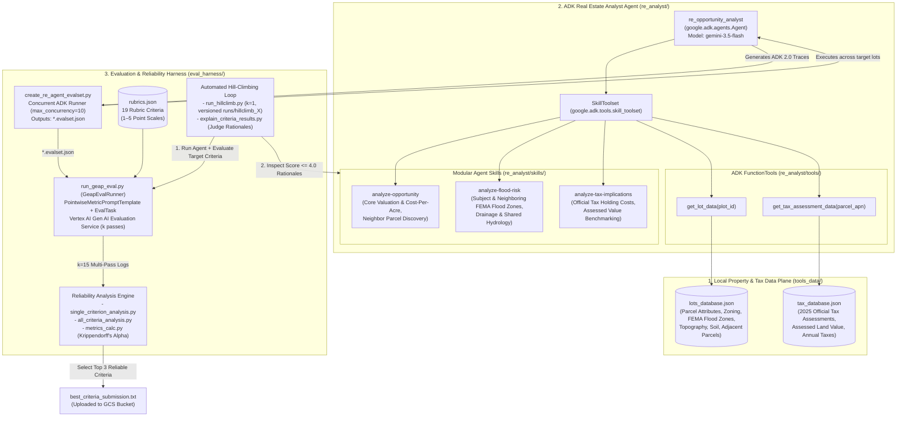

# Evaluating and Hill Climbing a Generative AI Agent Using Autoraters (L400-APEX006) — Complete Runbook, HLD, LLD & Workflows

> **Lab URL:** [https://explore.qwiklabs.com/classrooms/21504/labs/115876](https://explore.qwiklabs.com/classrooms/21504/labs/115876)  
> **Lab Code:** `L400-APEX006`  
> **Key Technologies:** Google Agent Development Kit (`google-adk==2.4.0`), Vertex AI Gen AI Evaluation Service (`google-cloud-aiplatform[evaluation]==1.160.0`), Gemini (`gemini-3.5-flash`), ADK `SkillToolset`, Intra-Rater Reliability Analysis (`krippendorff-aleph-alpha`, Pairwise Percent Agreement), Automated Agent Hill Climbing

---

## Repository Structure

| File / Directory | Description |
| :--- | :--- |
| [`README.md`](./README.md) | Master document containing Executive Summary, High-Level Design (HLD), Low-Level Design (LLD), Step-by-Step Workflows, and Full Operational Runbook |
| [`docs/HIGH_LEVEL_DESIGN.md`](./docs/HIGH_LEVEL_DESIGN.md) | High-Level Architecture Design (HLD), Agent & Evaluation Pipeline Architecture, Intra-Rater Reliability Statistical Architecture, and Hill-Climbing Loop |
| [`docs/LOW_LEVEL_DESIGN.md`](./docs/LOW_LEVEL_DESIGN.md) | Low-Level Design (LLD), ADK Agent & SkillToolset Specs, Evaluation Harness Module Specs, Statistical Formulas, 19-Criteria Reliability Table, and Skill Refinements |
| [`docs/WORKFLOWS.md`](./docs/WORKFLOWS.md) | Visual Mermaid Sequence & Flowchart Diagrams for every step of the lab (Tasks 1–6) |
| [`docs/RUNBOOK.md`](./docs/RUNBOOK.md) | Copy-pasteable Step-by-Step Operational Runbook covering Tasks 1–6 from session history and `agy` execution with verified outputs |
| [`re_analyst/`](./re_analyst/) | Hill-climbed ADK Real Estate Investment Opportunity Analysis Agent (`agent.py`, `tools/`, and refined `skills/*/SKILL.md` achieving `5.0000 / 5.0` mean scores) |
| [`eval_harness/`](./eval_harness/) | Complete evaluation and statistical reliability harness (`create_re_agent_evalset.py`, `run_geap_eval.py`, `single_criterion_analysis.py`, `all_criteria_analysis.py`, `run_hillclimb.py`, `explain_criteria_results.py`, `metrics_calc.py`, `rubrics.json`, `hillclimb_lots.txt`) |
| [`tools_data/`](./tools_data/) | Property and county tax databases (`lots_database.json` and `tax_database.json`) |
| [`runs/hillclimb_1/`](./runs/hillclimb_1/) & [`runs/hillclimb_2/`](./runs/hillclimb_2/) | Baseline (`1.1000` / `1.0000`) and Final Hill-Climbed (`5.0000` / `5.0000`) Vertex AI Gen AI Evaluation Service logs |
| [`best_criteria_submission.txt`](./best_criteria_submission.txt) | Verified Task 5 submission containing the top 3 reliable autorater criteria (`monthly-tax-holding,environmental-esa,flood-zone-flagging`) |

---

## 1. Executive Summary & Lab Objective

In this challenge lab (`L400-APEX006`), we evaluate and hill climb a real estate investment opportunity analysis agent (`re_analyst`) built with the **Google Agent Development Kit (ADK)** and powered by **Gemini (`gemini-3.5-flash`)**:

1. **Generate Baseline Agent Traces (Tasks 1–3):** Configure Python 3.13 and ADK, test the agent interactively via `adk web`, and execute `re_analyst` concurrently across 10 target vacant lots (`hillclimb_lots.txt`) to produce an ADK 2.0 `EvalSet` dataset (`hillclimb_lots.evalset.json`).
2. **Multi-Pass LLM-as-a-Judge Evaluation (Task 4):** Use `run_geap_eval.py` to compile 19 pointwise evaluation rubrics (`rubrics.json`) into `PointwiseMetricPromptTemplate` objects and run multi-pass ($k=3$) evaluations on the **Vertex AI Gen AI Evaluation Service**.
3. **Intra-Rater Reliability & Homogeneity Trap Analysis (Task 5):** Analyze a large evaluation dataset ($N=32$ lots $\times$ $19$ criteria $\times$ $k=15$ passes) using `single_criterion_analysis.py` and `all_criteria_analysis.py`. Distinguish true inter-pass agreement metrics (**Krippendorff's Alpha**, **Mean Pairwise Percent Agreement**, **Max Range Single Report**) and variance checks (**StdDev of Report Means**) from distractors, filter out criteria caught in the **Homogeneity Trap** (`general-tone`, `logical-flow`, `professionalism`, `readability`), and submit the top 3 reliable criteria:
   - `monthly-tax-holding` ($\alpha = 0.997$, $\text{SD Report Means} = 0.8872$, $\text{Pairwise Agree} = 99.17\%$)
   - `flood-zone-flagging` ($\alpha = 0.897$, $\text{SD Report Means} = 0.3357$, $\text{Pairwise Agree} = 94.41\%$)
   - `environmental-esa` ($\alpha = 0.897$, $\text{SD Report Means} = 0.7042$, $\text{Pairwise Agree} = 79.10\%$)
4. **Iterative Agent Hill Climbing (Task 6):** Diagnose baseline deficiencies (`hillclimb_1`: `cost-per-acre = 1.1000`, `neighboring-flood-risk = 1.0000`) using `explain_criteria_results.py`, refine the agent's three `SKILL.md` files in `re_analyst/skills/`, and execute `run_hillclimb.py` (`hillclimb_2`) to achieve a **perfect `5.0000 / 5.0` mean score** on both criteria.

---

## 2. High-Level Design (HLD)

> Full details in [`docs/HIGH_LEVEL_DESIGN.md`](./docs/HIGH_LEVEL_DESIGN.md).

---

## 3. Low-Level Design (LLD) Summary

> Full details in [`docs/LOW_LEVEL_DESIGN.md`](./docs/LOW_LEVEL_DESIGN.md).

### 3.1 Task 5 Intra-Rater Reliability Selection Matrix (`N=32, k=15`)

| Criterion ID | Mean | Min–Max | Max Range Report | SD Report Means | Pairwise % Agree | Alpha ($\alpha$) | Status |
| :--- | :---: | :---: | :---: | :---: | :---: | :---: | :--- |
| **`monthly-tax-holding`** | `2.2764` | `2–5` | `1` | `0.8872` | `99.17%` | **`0.997`** | **Selected (#1 Reliable)** |
| **`flood-zone-flagging`** | `4.8447` | `3–5` | `1` | `0.3357` | `94.41%` | **`0.897`** | **Selected (#2 Reliable)** |
| **`environmental-esa`** | `4.2772` | `2–5` | `3` | `0.7042` | `79.10%` | **`0.897`** | **Selected (#3 Reliable)** |
| `general-tone` / `logical-flow` / `professionalism` / `readability` | `5.0000` | `5–5` | `0` | **`0.0000`** | `100.00%` | `1` | **Rejected (Homogeneity Trap — Zero Variance)** |
| `neighboring-flood-risk` | `1.0316` | `1–2` | `0` | `0.1768` | `100.00%` | `1` | **Rejected (Floor Effect — 31/32 scored 1)** |

### 3.2 Task 6 Hill-Climbing Results (`hillclimb_1` vs. `hillclimb_2`)

| Criterion ID | Target Threshold | Baseline (`hillclimb_1`) | Final (`hillclimb_2`) | Key Skill Improvement |
| :--- | :---: | :---: | :---: | :--- |
| **`cost-per-acre`** | `> 4.0` | `1.1000` | **`5.0000`** | Explicit formula ($\text{Last Sale Price} / \text{Acreage}$), highlighted as core valuation metric in Executive Summary & Acquisition Basis, benchmarked against Assessed Land Value/Acre & neighboring lots |
| **`neighboring-flood-risk`** | `> 4.0` | `1.0000` | **`5.0000`** | Enabled `get_lot_data` in `analyze-flood-risk`, queried every lot ID in `adjacent_parcels`, reported exact FEMA flood zones, and analyzed cross-boundary runoff, soil permeability, and shared hydrological impacts |

---

## 4. Workflows & Step-by-Step Runbook

- **Visual Workflows (Mermaid Sequence & Flowchart Diagrams):** See [`docs/WORKFLOWS.md`](./docs/WORKFLOWS.md)
- **Complete Copy-Pasteable Operational Runbook (Tasks 1–6):** See [`docs/RUNBOOK.md`](./docs/RUNBOOK.md)
