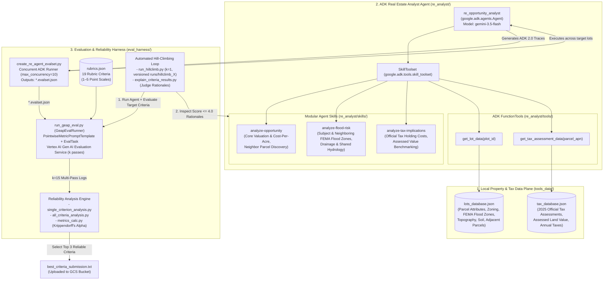

# High-Level Design (HLD) — Evaluating and Hill Climbing a Gen AI Agent Using Autoraters (L400-APEX006)

> **Lab URL:** [https://explore.qwiklabs.com/classrooms/21504/labs/115876](https://explore.qwiklabs.com/classrooms/21504/labs/115876)  
> **Lab Code:** `L400-APEX006`  
> **Core Stack:** Google Agent Development Kit (`google-adk==2.4.0`), Gemini (`gemini-3.5-flash` / Vertex AI), Vertex AI Gen AI Evaluation Service (`google-cloud-aiplatform[evaluation]==1.160.0`), Statistical Reliability Engine (`krippendorff-aleph-alpha`, `pandas`, `numpy`)

---

## 1. Architectural Vision & Problem Statement

Building production-grade Generative AI agents requires rigorous, scalable, and statistically reliable evaluation pipelines. When prototyping an agent at speed—often before human-labeled golden datasets are available to run human-vs-LLM judge correlation studies—engineering teams rely on **LLM-as-a-Judge Autoraters**.

However, LLM judges are stochastic and sensitive to rubric ambiguity. Before hill climbing an agent against a set of rubric criteria, an engineering team must answer two foundational questions:
1. **Intra-Rater Reliability (Self-Consistency):** If the same LLM judge evaluates the exact same set of $N$ agent reports across $k$ independent passes, does it assign consistent scores (`Krippendorff's Alpha`, `Pairwise Percent Agreement`, `Max Report Range`), and does it avoid the **Homogeneity Trap** (where every report receives the exact same score with zero discrimination across reports)?
2. **Closed-Loop Hill Climbing:** Once target evaluation criteria are established, how do we systematically diagnose agent deficiencies using judge rationales (`explain_criteria_results.py`) and iteratively refine the agent's modular `SkillToolset` (`SKILL.md` definitions) until mean evaluation scores exceed the target quality threshold ($> 4.0 / 5.0$)?

---

## 2. End-to-End System Architecture

---

## 3. Core Architectural Planes

### 3.1 Agent Execution Plane (`re_analyst`)
- **Framework:** Built on **Google Agent Development Kit (`google-adk==2.4.0`)** using an `App` wrapper around a root `Agent` (`re_opportunity_analyst`) powered by `gemini-3.5-flash` on Vertex AI.
- **Skill-Driven Reasoning (`SkillToolset`):** Rather than hardcoding all domain logic into a monolithic system prompt, the agent's `SYSTEM_INSTRUCTION` defines only the output memorandum structure (`Executive Summary`, `Acquisition Basis and Holding Costs`, `Zoning and Infrastructure Readiness`, `Risk Assessment`, `Recommendation`) and delegates domain investigation workflows to three modular skills loaded dynamically via `load_skill_from_dir`:
  1. `analyze-opportunity`
  2. `analyze-flood-risk`
  3. `analyze-tax-implications`
- **Tool Binding (`FunctionTool`):** Two deterministic Python tools (`get_lot_data` and `get_tax_assessment_data`) query in-memory cached JSON databases (`lots_database.json` and `tax_database.json`).

### 3.2 Cloud Evaluation Plane (`GeapEvalRunner` & Vertex AI Gen AI Evaluation Service)
- **Trace Extraction:** Extracts the final markdown memorandum from ADK 2.0 `EvalSet` JSON files (`case["conversation"][-1]["finalResponse"]["parts"][0]["text"]`).
- **Prompt Compilation:** Maps custom criteria and 1–5 rating scales from `eval_harness/rubrics.json` into `vertexai.evaluation.PointwiseMetricPromptTemplate` and `PointwiseMetric`.
- **Backend Majority Voting:** Each pointwise evaluation call to Vertex AI Gen AI Evaluation Service internally samples the judge model 4 times and returns a majority-voted score alongside a step-by-step explanation.
- **Multi-Pass Execution ($k$-Passes):** `run_geap_eval.py` executes `EvalTask.evaluate()` in a loop $k$ times (e.g., $k=3$ for baseline testing, $k=15$ for statistical reliability analysis) and logs runs under Vertex AI Experiments.

### 3.3 Statistical Intra-Rater Reliability Plane (`metrics_calc.py`)
To separate reliable autorater criteria from noisy criteria and statistical distractors across $N=32$ reports and $k=15$ evaluation passes, the architecture evaluates criteria across two orthogonal dimensions:
1. **Inter-Pass Consistency (Low Noise):**
   - High **Krippendorff's Alpha ($\alpha > 0.85$)** computed using interval metric distance across the $N \times k$ rating matrix.
   - High **Mean Pairwise Percent Agreement ($> 92\%$)** within each report row.
   - Tight **Widest Range Single Report ($\text{Max Range Report} \le 1$)**, ensuring no single report suffers wild score swings (e.g., 2 or 3 points) across passes.
2. **Between-Report Discrimination (Avoiding the Homogeneity Trap):**
   - Non-zero **StdDev of Report Means ($\text{SD Report Means} > 0.5$)** and full **Global Score Span ($\min=1, \max=5$)**.
   - Criteria such as `general-tone` and `logical-flow` give nearly every report a `5`, yielding `SD Report Means = 0.0000` (`alpha = NaN`) or `0.0236` (`alpha = -0.0007`). Despite high raw percent agreement (`100%` or `99.17%`), they have **zero discriminative power** and fail reliability checks.

### 3.4 Iterative Hill-Climbing Plane (`run_hillclimb.py` & `explain_criteria_results.py`)
- **Automated Versioned Evaluation:** `run_hillclimb.py` creates sequential run directories (`runs/hillclimb_1`, `runs/hillclimb_2`, ...), executes the ADK agent concurrently across the 10 target lots in `eval_harness/hillclimb_lots.txt`, runs a single-pass ($k=1$) evaluation on the two target hill-climbing criteria (`cost-per-acre` and `neighboring-flood-risk`), and computes mean scores.
- **Diagnostic Feedback Loop:** `explain_criteria_results.py` filters judge rationales for reports scoring $\le 4.0$, revealing exact rubric gaps in the baseline skills and guiding targeted refinements to `re_analyst/skills/*/SKILL.md`.

---

## 4. Hill-Climbing Transformation Summary (Baseline vs. Final)

| Dimension | Baseline State (`hillclimb_1`) | Hill-Climbed State (`hillclimb_2`) |
| :--- | :--- | :--- |
| **`cost-per-acre` Mean Score** | **`1.1000 / 5.0`** (Omitted explicit cost-per-acre formula & calculation) | **`5.0000 / 5.0`** (10/10 reports derive exact $\text{Last Sale Price}/\text{Acreage}$, highlight as core metric, and benchmark against assessed & neighbor values) |
| **`neighboring-flood-risk` Mean Score** | **`1.0000 / 5.0`** (Evaluated only subject lot; ignored `adjacent_parcels`) | **`5.0000 / 5.0`** (10/10 reports query `get_lot_data` for all `adjacent_parcels`, report exact FEMA zones, and analyze drainage, runoff, and shared hydrology) |
| **Tool Invocations per Lot** | `get_lot_data(subject)` + `get_tax_assessment_data(apn)` | `get_lot_data(subject)` + `get_lot_data(neighbor_1..n)` + `get_tax_assessment_data(apn)` |
