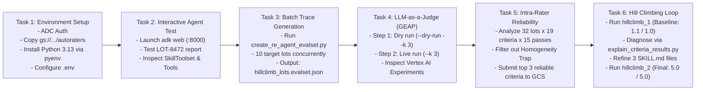
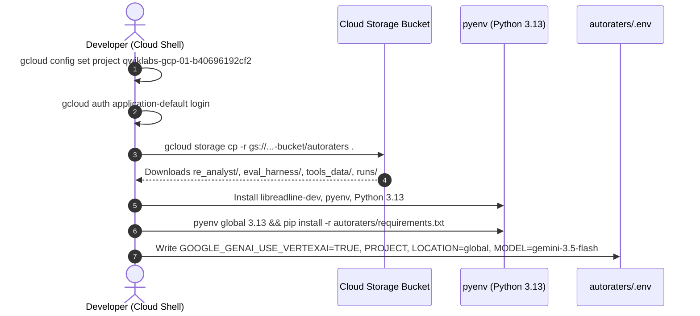
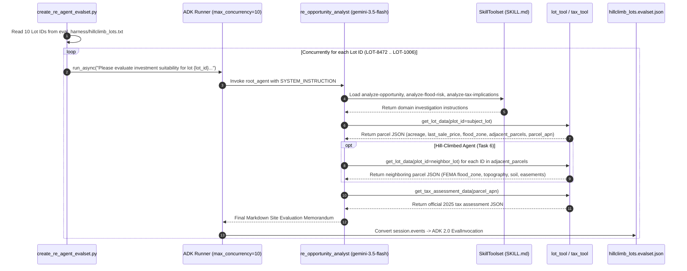
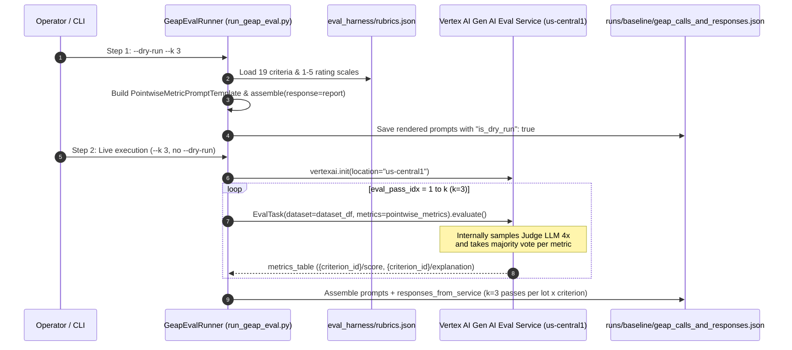
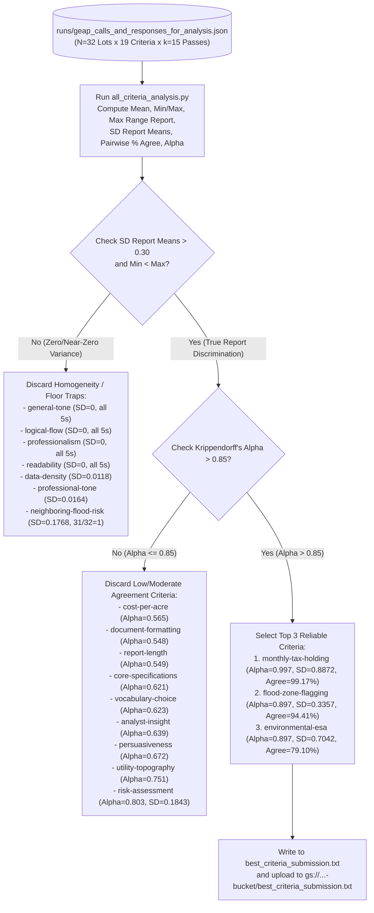
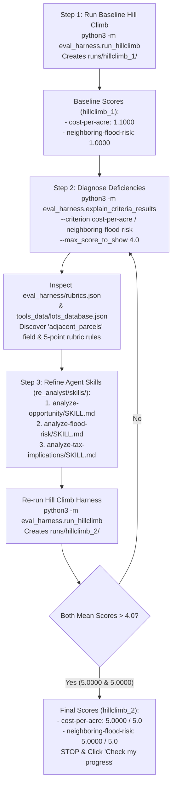

# Step-by-Step Workflows — Evaluating and Hill Climbing a Gen AI Agent Using Autoraters (L400-APEX006)

> **Lab URL:** [https://explore.qwiklabs.com/classrooms/21504/labs/115876](https://explore.qwiklabs.com/classrooms/21504/labs/115876)  
> **Lab Code:** `L400-APEX006`

---

## 1. Master End-to-End Lab Workflow (Tasks 1–6)

---

## 2. Task 1 Workflow: Environment Provisioning & Authentication

---

## 3. Task 2 & Task 3 Workflow: ADK Agent Execution & EvalSet Generation

---

## 4. Task 4 Workflow: Multi-Pass LLM-as-a-Judge Evaluation (`run_geap_eval.py`)

---

## 5. Task 5 Workflow: Intra-Rater Reliability & Homogeneity Trap Filtering

---

## 6. Task 6 Workflow: Iterative Hill-Climbing Automation

